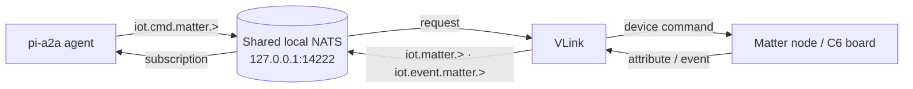

# VLink

**Your first smart device — powered by agents.**

VLink is the `omp.sh` hardware experience: plug in a small ESP32 board, and your AI
agents can see it, talk to it, and make it react. Young makers describe what they
want in plain English inside `omp`; VLink translates that into device telemetry and
commands on the **shared local NATS bus that `pi-a2a` already runs**. It is the IoT
counterpart to `pi-a2a`: `pi-a2a` moves agent messages, VLink moves device messages,
and both share one localhost bus.

| | |
|---|---|
| **Status** | Bridge scaffold `0.1.0` — usable today against Matter devices and the simulator. The maker firmware and `omp vlink` CLI (§3) are the next milestones, not shipped code. |
| **Runtime** | TypeScript. OMP extension entry point + optional standalone sidecar. |
| **Matter stack** | [`matter.js`](https://github.com/project-chip/matter.js) `0.18.x` controller (`ServerNode` + `ControllerBehavior`). Not certified Matter. |
| **NATS** | Connects to `pi-a2a`'s existing server, default `nats://127.0.0.1:14222`. VLink never starts its own broker. |
| **Maker board** | Waveshare **ESP32-C6-LCD-1.47** (ESP32-C6FH8, Wi-Fi 6 + BLE 5 + 802.15.4, 8 MB flash, 320×172 ST7789, BOOT on GPIO9). See §4. |
| **Any Matter node** | ESP32-C3/S3 running `esp-matter`; Wi-Fi operational transport, BLE for commissioning. |
| **Spec** | [`vlink_framework.md`](./vlink_framework.md) (v2 goals) · [`vlink_prd.md`](./vlink_prd.md) (v1 bridge intent) |

---

## 1. The idea: an agentic tamagotchi

You keep an `omp` session open on your Mac. Sitting next to it is a little board
with a screen, one button, and an RGB LED. Three things close the loop:

1. **You vibe.** "Make the screen retro green and flash the LED when a build
   finishes."
2. **Agents act.** The agent publishes a command on the local NATS bus
   (`iot.cmd.matter.…`); VLink forwards it to the device; the screen updates and
   the LED flashes — target under 50 ms.
3. **The device talks back.** Press the board's BOOT button and it emits an event
   (`iot.event.matter.…`) that lands in your agent's transcript; telemetry
   (`iot.matter.…`) streams as it changes. The agent *sees* the hardware.

No IDE, no datasheets, no serial consoles required for the journey above — that is
what VLink is for. (Engineers can still open the hood; §5–§9 is the full wire
contract.)

### What works today, honestly

| Piece | State |
|---|---|
| Agent ↔ device messaging over shared NATS | **Works** — request-reply commands, telemetry, events, health |
| OMP tools (`vlink_status`, `vlink_command`, …) | **Works** — 7 tools, 4 slash commands |
| Matter controller (commission/read/command real esp-matter nodes) | **Works in scaffold verification**; full ESP32 lab pass pending |
| Simulator device (no hardware at all) | **Works** — `bun run dev:sim` |
| Terminal commissioning + smoke CLIs | **Works** |
| Maker firmware for the C6-LCD board (LVGL zones, button event, RGB LED) | **Not built** — §3 milestone F1 |
| `omp vlink attach / flash / stream` CLI | **Not built** — §3 milestone F3 |
| Sidecar supervision from OMP | **Not wired** — sidecar entry exists, runs standalone |

The board on the lab bench (`debian@danilab`, `/dev/ttyACM0`) currently runs the
VKey token firmware, not VLink firmware — it is the *board*, not yet the *product*.

---

## 2. Quick start (5 minutes, no hardware)

```bash
cd vclaw-desktop/vlink
bun install
bun run typecheck
bun test

# Register with OMP (symlink, no publish)
omp plugin link "$PWD"
omp plugin list
```

Restart OMP (extension modules load at session start), then:

```text
/vlink-status
```

You should see bridge state, NATS connectivity, and Matter mode. If `pi-a2a`'s
NATS server is up, you are already on the bus. To watch the whole loop without a
device:

```bash
bun run dev:sim          # simulator Matter adapter + local test NATS
bun run nats:smoke       # request-reply on iot.cmd.matter.<fabric>.bridge.status
```

The package declares its extension in `package.json`:

```json
{
  "omp": { "extensions": ["./src/index.ts"] }
}
```

---

## 3. The maker roadmap (v2 goals, in build order)

The framework's promise is the journey in §1 on the Waveshare ESP32-C6-LCD board.
The milestones, each one usable on its own:

| # | Milestone | What you get |
|---|---|---|
| F0 | **Bridge scaffold** *(done)* | Everything in §1's "works today" table. |
| F1 | **C6 firmware app** — an ESP-IDF/LVGL component for the C6-LCD board with the three zones: (A) connection status (NATS/pi-a2a), (B) agent avatar/canvas, (C) live telemetry ticker; BOOT (GPIO9) publishes a button event; the RGB LED reflects bus state. | The board becomes a VLink device: it shows your agents' activity and its button reaches your agents. |
| F2 | **Device-side transport** — the C6 joins Wi-Fi and speaks the §5 contract directly (and/or joins the Matter fabric; the board's radios support both). | Telemetry and commands flow without USB. |
| F3 | **`omp vlink` CLI** — `omp vlink attach` (auto-detect the board over USB `303a:1001`), `omp vlink flash` (build + flash in one command), `omp vlink stream` (live serial/telemetry monitor). | Zero-friction onboarding: plug in, one command, done. |
| F4 | **Vibe workflow hardening** — the <50 ms LVGL update assertion, "set screen mode to Retro" end-to-end test, reflash cycles that don't lose pairing. | The demo that sells it. |

Framework corrections carried into the plan (same honesty as §12): NATS is on
`127.0.0.1:14222`, not 4222; concrete subjects carry `<endpoint>`; BLE is the
commissioning rendezvous, not an operational transport. The C6's LED pin and
button mapping are the framework's stated values (RGB GPIO8, BOOT GPIO9) and get
verified against the board schematic when F1 starts — this board's lineage wires
a second button on GPIO18 and the production LED bead is a board fact to re-check,
not to assume.

---

## 4. Hardware

### 4.1 The maker board: Waveshare ESP32-C6-LCD-1.47

| | |
|---|---|
| Silicon | ESP32-C6FH8 (QFN32) rev v0.2 — Wi-Fi 6, BLE 5, 802.15.4/Thread, 8 MB embedded flash, no RTC |
| Display | ST7789, native 172×320, driven landscape 320×172, no touch |
| Buttons | BOOT on GPIO9 (primary); GPIO18 wired for expansion |
| LED | one addressable RGB bead |
| USB | USB-Serial/JTAG CDC (vendor `303a:1001`) |
| Identity | no chip ID on C6 — the eFuse BASE MAC is the device identity |

Flash budget: firmware must fit the 8 MB partition table (framework target
< 1.5 MB). One lab board is provisioned and backed up; its VKey-lineage image is
restorable, so flashing F1 onto it is reversible.

### 4.2 Any Matter node (the bridge's original target)

ESP32-C3/S3 devkits running Espressif's `esp-matter` examples work through the
Matter controller today. The board does not need a screen — VLink treats every
commissioned Matter node the same way:

```bash
# one-time, outside this repo
git clone --recursive https://github.com/espressif/esp-matter.git
cd esp-matter && ./install.sh && . ./export.sh

# build/flash the light example
cd examples/light
idf.py set-target esp32c3
idf.py build flash monitor
```

Use the manual pairing code from the serial log; VLink commissions it over BLE and
installs your Wi-Fi credentials. Full lab procedure:
[`docs/ESP32_LAB.md`](./docs/ESP32_LAB.md).

> **Do not commit Wi-Fi passwords, pairing codes, or the NATS token.** The scripts
> accept them from environment variables or a 0600 local file.

---

## 5. Shared NATS contract (the important part)

`pi-a2a` already owns the local server:

| Item | Value |
|---|---|
| URL | `nats://127.0.0.1:14222` |
| Config | `A2A/pi-a2a/config/nats-ipc.conf` |
| Auth | token in `~/.config/pi-a2a/server.seed` (0600) |
| Policy | localhost-only; no leafnode, no cloud hub, no WAN |
| Permissions | `default_permissions { publish: [">"], subscribe: [">"] }` |

VLink **connects to that server**, with the same token, and reserves `iot.>`. It
does not add a second broker, a second port, an account, or a leafnode. It does
not touch `agents.>`, `a2a.>`, `$SRV.>`, or `$KV.>`.



### 5.1 Subject taxonomy

| Purpose | Subject | Example |
|---|---|---|
| Attribute telemetry | `iot.matter.<fabric>.<node>.<endpoint>.<cluster>.<attribute>` | `iot.matter.fabric-…1.node-…2a.1.onOff.onOff` |
| Device command | `iot.cmd.matter.<fabric>.<node>.<endpoint>.<cluster>.<command>` | `iot.cmd.matter.fabric-…1.node-…2a.1.onOff.toggle` |
| Device event | `iot.event.matter.<fabric>.<node>.<endpoint>.<cluster>.<event>` | `iot.event.matter.fabric-…1.node-…2a.1.switch.latchSwitch` |
| Bridge operation | `iot.cmd.matter.<fabric>.bridge.<action>` | `iot.cmd.matter.fabric-…1.bridge.commission` |
| Bridge health | `iot.bridge.vlink.<instance>.status` | `iot.bridge.vlink.local.status` |

Rules:

- **`fabric`** is `fabric-<16 lowercase hex>` from the Matter fabric ID, or a
  configured stable label for simulator/tests.
- **`node`** is `node-<16 lowercase hex>` from the Matter node ID. A human alias
  is metadata, never the subject identity.
- **`endpoint`** is the numeric Matter endpoint — one node can expose the same
  cluster on several endpoints; omitting it collides.
- **`cluster` / `attribute` / `command`** are lower-camel Matter names
  (`OnOff` → `onOff`).
- Concrete subjects never contain `*` or `>`; only subscriptions use wildcards.
- Command subscriptions use the queue group `vlink` so only one VLink instance per
  fabric executes a command.

### 5.2 Payloads

All payloads are UTF-8 JSON with `"v": 1`.

**Attribute telemetry**

```json
{
  "v": 1,
  "type": "attribute",
  "fabricId": "fabric-0000000000000001",
  "nodeId": "node-000000000000002a",
  "endpointId": 1,
  "cluster": "onOff",
  "attribute": "onOff",
  "value": true,
  "previousValue": false,
  "timestamp": 1762819200000,
  "nodeName": "desk-lamp",
  "source": "subscription"
}
```

**Device command**

```json
{
  "v": 1,
  "type": "command",
  "requestId": "01J9...",
  "nodeId": "node-000000000000002a",
  "endpointId": 1,
  "cluster": "onOff",
  "command": "toggle",
  "args": {},
  "timeoutMs": 5000
}
```

**Bridge operation**

```json
{
  "v": 1,
  "type": "bridge",
  "requestId": "01J9...",
  "action": "commission",
  "pairingCode": "34970112332",
  "transport": "ble-wifi",
  "wifi": { "ssid": "lab-iot", "password": "…" },
  "timeoutMs": 120000
}
```

**Reply (NATS `msg.reply`)**

```json
{
  "v": 1,
  "ok": true,
  "requestId": "01J9...",
  "nodeId": "node-000000000000002a",
  "endpointId": 1,
  "cluster": "onOff",
  "command": "toggle",
  "data": { "onOff": true },
  "startedAt": 1762819200000,
  "completedAt": 1762819200042,
  "durationMs": 42
}
```

Errors use `ok: false` and:

```json
{
  "v": 1,
  "ok": false,
  "error": {
    "code": "MATTER_COMMAND_FAILED",
    "message": "device returned UNSUPPORTED_COMMAND",
    "details": {}
  }
}
```

**Why core NATS request-reply, not JetStream, in v1:** core NATS gives the
required latency and the exact agent-to-device semantics. JetStream is Phase 2
(durable replay of device history, offline buffering, cross-WAN leaf sync). VLink
creates no streams, consumers, or KV buckets today.

### 5.3 The CDC device bridge

The ESP32-C6 maker board (§4.1) has no Wi-Fi link to the bus yet — the host
bridge is its transport over USB-CDC (`303a:1001`), translating the line
protocol in [`docs/CDC_PROTOCOL.md`](./docs/CDC_PROTOCOL.md) to/from the
subjects above: button presses publish on `iot.event.matter.>`, `state` /
`telemetry` / `tick` on `iot.matter.>`, and
`iot.cmd.matter.<fabric>.<node>.1.display.>` requests become `render`/`event`
lines with echo-gated `ok` replies (2 s → `DEVICE_TIMEOUT`). The device's
node id is its zero-padded BASE MAC, learned from its `hello`. A missing board
is normal: the bridge stays idle and health reports `cdcConnected: false`.

---

## 6. Runtime model

VLink ships two entry points over one shared core:

```text
src/index.ts       OMP extension: lifecycle, tools, slash commands, notifications
src/sidecar.ts     standalone bridge process: Matter + NATS, no OMP dependency
src/runtime.ts     shared VLinkRuntime: init → start → stop, adapters, state
src/cdc/           CDC device bridge: transport, protocol codecs, NATS mapping
```

The OMP extension is a **supervisor**. Today it runs the bridge **in-process**:
`src/plugin.ts` starts `VLinkRuntime` on `session_start` and stops it on
`session_shutdown`. `src/sidecar.ts` runs the same composition standalone;
OMP-side sidecar supervision is **not wired yet** (`VLINK_MODE=sidecar` logs a
warning and falls back in-process). The sidecar is the production escape hatch —
Matter.js/BLE native code belongs outside the editor process — and milestones
F2/F3 build on it. Until then, keep a terminal available for `bun run sidecar`
debugging.

| State | Meaning |
|---|---|
| `stopped` | No NATS connection, no Matter controller. |
| `starting` | Loading config, connecting NATS, opening Matter controller (and BLE if enabled). |
| `ready` | NATS subscribed, Matter controller online, discovery/subscription active. |
| `degraded` | One dependency is down (usually Matter/BLE); NATS remains available for status. |
| `stopping` | Unsubscribing, closing Matter, draining timers. |

`start()` and `stop()` are idempotent. A failed start leaves `lastError` in the
health payload; it never throws into the OMP session.

---

## 7. Configuration

Resolution order: environment variables → `~/.omp/vlink/config.json` → defaults.
Secrets are read from files or the environment; they are never written to the
config file by VLink and never logged.

| Variable | Default | Purpose |
|---|---|---|
| `VLINK_NATS_URL` | `nats://127.0.0.1:14222` | Shared `pi-a2a` NATS server. |
| `VLINK_NATS_TOKEN_FILE` | `~/.config/pi-a2a/server.seed` | Token file; same auth as `pi-a2a`. |
| `VLINK_NATS_TOKEN` | — | Direct token override (tests/CI). Prefer the file. |
| `VLINK_NATS_NAME` | `vlink` | NATS client name for the bridge connection. |
| `VLINK_FABRIC_ID` | derived from Matter fabric | Stable `fabric-<hex>` label; set for simulator/tests. |
| `VLINK_FABRIC_LABEL` | `VLink` | Matter administrator fabric label. |
| `VLINK_STATE_DIR` | `~/.omp/vlink` | Node alias/state JSON. |
| `VLINK_MATTER_STORAGE` | `~/.omp/vlink/matter` | Matter.js storage root. |
| `VLINK_MATTER_MODE` | `matter` | `matter`, `sim`, or `off`. |
| `VLINK_BLE_ENABLED` | `true` | Load BLE central support before controller creation. |
| `VLINK_WIFI_SSID` | — | Default Wi-Fi SSID for BLE commissioning. |
| `VLINK_WIFI_PASSWORD` | — | Default Wi-Fi password; prefer per-command payload or env. |
| `VLINK_COMMAND_QUEUE` | `vlink` | NATS queue group for command subscriptions. |
| `VLINK_HEALTH_INTERVAL_MS` | `30000` | Health publish interval; `0` disables. |
| `VLINK_RECONNECT_WAIT_MS` | `2000` | NATS reconnect wait. |
| `VLINK_LOG_LEVEL` | `info` | `debug`, `info`, `warn`, `error`. |
| `VLINK_NOTIFY_EVENTS` | `false` | Surface device events in the OMP transcript. |
| `VLINK_INSTANCE_ID` | sanitized hostname | Instance token in health subjects. |
| `VLINK_DEFAULT_COMMAND_TIMEOUT_MS` | `5000` | Default device command timeout. |
| `VLINK_DEFAULT_COMMISSION_TIMEOUT_MS` | `120000` | Default commissioning timeout. |
| `VLINK_CDC_ENABLED` | `true` | Enable the USB-CDC bridge to the C6 board. |
| `VLINK_CDC_DEVICE` | auto-discover | Explicit CDC device path (skips discovery). |

Example `~/.omp/vlink/config.json`:

```json
{
  "natsUrl": "nats://127.0.0.1:14222",
  "fabricLabel": "VLink",
  "matterMode": "matter",
  "bleEnabled": true,
  "notifyEvents": false
}
```

The NATS token is **not** in this file. `pi-a2a` already keeps it at
`~/.config/pi-a2a/server.seed`; VLink reuses it.

---

## 8. Commands you can run

### 8.1 Development without OMP

```bash
bun run dev:sim          # simulator + local test NATS, no hardware
bun run sidecar          # real Matter bridge process
```

### 8.2 NATS smoke test

```bash
bun run nats:smoke
```

Connects with the `pi-a2a` token and verifies request-reply on
`iot.cmd.matter.<fabric>.bridge.status`. Needs no Matter device.

### 8.3 Commissioning from a terminal

`bun run commission` is the no-OMP path for bridge operations — it talks NATS
request-reply to whichever bridge is live (in-process or sidecar), so it needs no
Bluetooth permissions and never runs Matter code itself:

```bash
bun run commission list [fabric]        # commissioned nodes
bun run commission status [fabric]      # bridge health
bun run commission [fabric]             # commission (creds from env/file)
bun run commission decommission <nodeId> [--force] [fabric]
```

The fabric defaults to `VLINK_FABRIC_ID`. Secrets come from `VLINK_PAIRING_CODE` /
`VLINK_WIFI_SSID` / `VLINK_WIFI_PASSWORD`, or a 0600 JSON file at
`VLINK_COMMISSION_FILE` (default `~/.omp/vlink/commission.local.json`,
gitignored); the script refuses a group/world-readable file and never prints the
values.

### 8.4 Hardware smoke

```bash
bun run hw:smoke
```

Runs `tests/hardware` with `VLINK_HW=1`, failing loudly when the required lab
variables (`VLINK_HW_PAIRING_CODE`, `VLINK_HW_WIFI_SSID`, `VLINK_HW_WIFI_PASSWORD`)
are missing — the test itself skips silently, which is right for CI but not for a
smoke command.

---

## 9. OMP tools and slash commands

| Tool | Purpose |
|---|---|
| `vlink_status` | Bridge state, NATS/Matter health, commissioned node count. |
| `vlink_nodes` | List commissioned nodes with node ID, alias, endpoints, connection state. |
| `vlink_discover` | Discover commissionable Matter devices (BLE/IP) for N seconds. |
| `vlink_commission` | Commission a device over BLE+Wi-Fi or IP. |
| `vlink_read` | Read an attribute from the local Matter cache. |
| `vlink_command` | Invoke a Matter cluster command with args; returns the ACK. |
| `vlink_decommission` | Remove a device from the VLink fabric. |

Slash commands: `/vlink-status`, `/vlink-nodes`, `/vlink-discover`,
`/vlink-commission`. Tools return structured text plus `details` for the UI;
long-running commissioning reports progress through `onUpdate`.

**Matter connectivity, stated precisely.** Matter separates commissioning
(discovery over BLE, or IP if the device is already on the LAN; PASE; Wi-Fi
credentials installed) from operational transport (IPv6 over Wi-Fi/Thread; CASE
sessions; subscriptions). BLE is **not** a control transport after commissioning.
On macOS the first BLE scan triggers a Bluetooth permission prompt; BLE from a
headless/sandboxed process is unsupported — use IP commissioning there. Fabric and
peer state live under `~/.omp/vlink/matter/`; do not delete it unless you mean to
re-commission everything.

---

## 10. Testing

| Layer | Command | Needs hardware? |
|---|---|---|
| Unit: subjects, config, payload validation, router, lifecycle | `bun test tests/unit` | No |
| Integration: real NATS request-reply with simulator adapter | `bun test tests/integration` | No (spawns `nats-server` if installed) |
| Matter.js controller smoke (no device) | `VLINK_MATTER_SMOKE=1 bun test tests/integration/matter-smoke.test.ts` | No |
| ESP32 hardware: commission, read, toggle, latency | `bun run hw:smoke` | Yes, ESP32-C3/S3 |
| Full lab procedure | [`docs/TEST_PLAN.md`](./docs/TEST_PLAN.md) | Yes |

Latency targets are test assertions, not marketing: inter-plugin NATS handoff
< 2 ms and end-to-end command < 50 ms on a LAN (the framework's < 100 ms Wi-Fi-6
figure becomes an assertion in F2). The hardware suite records min/median/p95/max
and gates p95 at `VLINK_HW_P95_MS` (default 50 ms).

---

## 11. Security and limitations

- **Localhost trust boundary.** The shared NATS server is token-auth, bound to
  `127.0.0.1`, with no leafnode. VLink inherits that boundary; it exposes no
  network listener.
- **Topic authorization is not per-device.** Any process with the local NATS
  token can command any commissioned device. Per-fabric NATS accounts/subject
  ACLs are a hardening step, not a v1 guarantee.
- **Wi-Fi credentials** transit BLE commissioning and the command payload. They
  are not persisted by VLink, but may appear in OMP transcripts if passed through
  a tool call. Prefer `VLINK_WIFI_*` env or a 0600 file for real labs.
- **Matter.js is not certified.** A development controller — right for the maker
  lab, not for shipping a certified product.
- **BLE support depends on the host.** macOS needs Bluetooth permission; Linux
  needs the noble prerequisites; Windows is best-effort. IP commissioning is the
  fallback.
- **One real controller per host.** Matter.js binds mDNS UDP 5353 and owns a
  storage directory per controller. Do not run two `MatterJsAdapter` instances on
  one machine; the `vlink` queue group prevents duplicate command execution, not
  controller contention.
- **Not implemented yet:** OMP-side sidecar supervision, JetStream replay,
  multi-fabric subject accounts, OTA, generic write-attribute for every cluster,
  groupcast, a GUI — and the §3 milestones F1–F4 (maker firmware, device-side
  transport, `omp vlink` CLI, workflow hardening).

### Verification status (scaffold)

| Check | Result |
|---|---|
| `bun run typecheck` | Pass |
| `bun test` (unit + integration) | 107 pass, 2 skip (Matter smoke + hardware gated) |
| `VLINK_MATTER_SMOKE=1 bun test` | 108 pass, 1 skip (hardware gated) |
| `bun run nats:smoke` against live `pi-a2a` on `127.0.0.1:14222` | Pass (bridge status reply, `iot.>` observed) |
| OMP plugin load + tool/command registration | Pass (7 tools, 4 commands) |
| In-process bridge under the OMP extension host | Pass (2026-11-11, after the module-identity fix: `state: ready`, Matter logs routed to the structured logger, no TUI garble) |
| `bun run commission status/list` against the live bridge | Pass (request-reply round trip; structured error paths verified) |
| `bun run hw:smoke` without lab env | Pass (fails loudly, listing the missing variables) |
| Matter.js `ServerNode` + `ControllerBehavior` create/start/close under Bun | Pass |
| BLE import + `bleAvailable:true` | Pass; real BLE commissioning not yet hardware-tested |
| ESP32 commissioning/toggle/latency | **Not yet run** — requires the lab in `docs/ESP32_LAB.md` |
| Lab board on `debian@danilab` (`/dev/ttyACM0`) | Measured 2026-11-11: ESP32-C6-LCD-1.47, VKey `v1.0.0-12-g0a0e9d7-dirty` firmware, boots clean, 0 accounts — awaiting F1 |

---

## 12. Relationship to the specs

`vlink_framework.md` (v2, maker edition) is the goal; `vlink_prd.md` (v1) is the
bridge intent. Both are honored with the same implementation-level corrections,
measured against the live environment and Matter.js 0.18:

| Spec says | VLink does | Why |
|---|---|---|
| Shared NATS at `127.0.0.1:4222` | `127.0.0.1:14222`, reuse `pi-a2a` token | The live `pi-a2a` server is on 14222; 4222 is not running locally. |
| Subject omits endpoint / uses `device_id` | Subject includes `<endpoint>`; identity is `node-<hex>` | One node can expose the same cluster on multiple endpoints; omitting it collides. Stable IDs beat human names. |
| `init/start/stop` hooks | Same lifecycle inside `VLinkRuntime`, exposed through OMP `session_start`/`session_shutdown` | OMP extensions have no `init/start/stop` API; they use event handlers. |
| BLE as a connectivity mode | BLE for commissioning; Wi-Fi/Thread for operations | Matter operational transport is IP; BLE is the commissioning rendezvous. |
| `CommissioningController` | `ServerNode` + `ControllerBehavior` + `PeerSet` | The legacy controller API is deprecated in Matter.js 0.18 and removed in 0.19. |
| `omp vlink flash/stream` (framework) | §3 milestone F3, not built | Needs F1 firmware first; the CLI is trivial once there is something to flash. |

---

## 13. Repository layout

```text
vlink/
  README.md              this file
  vlink_framework.md     v2 maker-edition goals
  vlink_prd.md           v1 bridge product requirements
  package.json           OMP extension manifest + scripts
  tsconfig.json
  src/
    index.ts             OMP extension entry
    sidecar.ts           standalone bridge entry
    runtime.ts           VLinkRuntime lifecycle
    config.ts            env/file config
    types.ts             shared types
    subjects.ts          subject taxonomy
    nats/                transport, command router, telemetry publisher
    matter/              adapter, Matter.js controller, simulator, clusters
    omp/                 tools, slash commands, formatting
  tests/                 unit, integration, hardware
  scripts/               dev simulator, NATS smoke, commissioning, HW smoke
  docs/                  architecture, subjects, test plan, ESP32 lab
```

Design internals (module boundaries, state machine, the omp module-identity
constraint) live in [`docs/ARCHITECTURE.md`](./docs/ARCHITECTURE.md).
